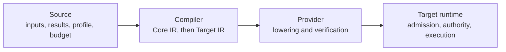

# Amblicit

***Use only as declared.***

**Amblicit is lawful computation within explicit bounds.** An Amblicit program states what it will read, what it may change, what it costs and how it can fail. The compiler checks that statement before anything runs. The result is a digest-bound artifact that a runtime can review, admit and replay.

> [!NOTE]
> Amblicit was previously named **Edict**. The rename happens in stages. Crate names, the `edict` CLI, `.edict` source files and `edict.*` wire identifiers keep their current names until their stage lands. The [name decision](./docs/design/amblicit-name.md) lists every current and planned name.

Amblicit is alpha software. The compiler, the CLI and Target IR exist and have tests. Runtime execution belongs to the target runtime, such as [Echo](https://github.com/flyingrobots/echo). [Current status](#current-status) lists what works today.

## Why Amblicit exists

A function's name says what it does. Its process decides what it *can* do:

```typescript
async function getMessageThread(userId: string, threadId: string) {
  const thread = await db.threads.findOne({ id: threadId });
  const messages = await db.messages.findMany({ threadId });
  return { thread, messages };
}
```

This function can read any table, call any service and write any file that its process can reach. Only code review keeps it to one thread. The project calls this gap **FIDLAR**: *Footprints Ignored; Developer Lies About Risk*.

The gap is larger when an AI agent calls the function, because the agent can do anything that the process can do. Amblicit closes the gap at the definition, not at the call site. An operation must declare its reads, writes, cost and failures. The compiler refuses anything outside that declaration.

## The four bounds

An Amblicit program declares its bounds in four dimensions. Authority exists today. The other three are planned directions.

| Bound | Promise | Posture |
| --- | --- | --- |
| **Authority** | *Nothing you didn't bring.* A program can use only its explicit inputs and the law that it imports and pins by digest. It proposes a change; the runtime decides whether to admit it. | Current |
| **State** | *Everything has a place.* A program creates a thing by adding it to a collection and deletes it by removing it. There are no raw pointers and no orphans. | Planned |
| **History** | *Ask the past. Get a receipt.* A program can ask what a reading was at an earlier basis, or whether its dependencies changed, and receive the answer with its evidence. The amount of history that a machine keeps never changes the answer. | Planned |
| **Possibilities** | *Try tomorrow. Change nothing.* A program can preview what an operation would change at the current state, without changing anything. | Planned |

## Principles

These invariants come from the [language specification](./docs/SPEC_edict-language-v1.md).

| Principle | Meaning | Spec |
| --- | --- | --- |
| No ambient authority | No clock, randomness, filesystem, network or environment unless the caller supplies it as explicit input | I-002, I-003 |
| Deterministic | The same source and pinned law produce byte-identical artifacts | I-003, I-010 |
| Total | Loops walk finite, bounded collections. Recursion is refused. Cost is checked against a budget. | I-004, I-016 |
| Typed effects | Effects come from imported, digest-locked lawpacks and target profiles, not from footprint text that an author writes | I-005, I-008 |
| Failure is a value | Every effect that can fail maps to a named obstruction. There are no exceptions. | I-012, I-025 |
| Runtime-neutral core | Core IR has no nodes, rows, keys or commits. A target profile owns storage and lowering. | I-001, I-011 |
| Atomic | An intent applies as one unit, or it leaves the target state unchanged | I-029 |
| Evidence is not authority | Digests and certificates record what was checked. The runtime decides admission. | I-014, I-028 |

## A first intent

This intent is [`fixtures/lang/bounds/bounded-hello.edict`](./fixtures/lang/bounds/bounded-hello.edict):

```graphql
package examples.hello@1;

use lawpack hello.optics@1 digest "sha256:0000000000000000000000000000000000000000000000000000000000000000" as hello;

type HelloInput = {
  name: String<max=256>,
};

type HelloReading = {
  message: String<max=512>,
};

intent sayHello(input: HelloInput)
  returns HelloReading
  profile hello.readOnly
  basis none
  budget <= hello.tinyBudget
  where input.name != ""
{
  let message = "hello, " + input.name;
  return { message };
}
```

- Each type has a bound, such as `String<max=256>`. Thus the cost is known before execution.
- `use lawpack ... digest` pins the law that the intent depends on to an exact hash. A change to the law changes the identity of the artifact.
- `profile` and `budget` are claims. When the compiler lowers the intent, it resolves them against compiler-context facts that the caller supplies. The `check` operation does not load these facts or a lawpack.
- `basis none` declares that the intent does not need a basis.
- The body cannot reach a database, a clock or a network.

## Effects and failure

An effect must be bound with `let` before its value is used, so the order of effects is visible (A-normal form). Each effect states how it can fail. The example below shows the design. It includes syntax that the current compiler does not lower:

```graphql
intent createEntry(input: shape.EntryInput)
  returns shape.EntryReceipt | history.EntryObstruction
  profile history.readWrite
  budget <= history.createEntryBudget
{
  require history.basisFresh(input.basis)
    else history.EntryObstruction.StaleBase { providedBasis: input.basis };

  let entry = history.entry.record({
    content: input.content,
    author:  input.author,
    basis:   input.basis,
  }) else {
    conflict => history.EntryObstruction.Conflict { ... },
  };

  reveal entry;
}
```

`StaleBase` and `Conflict` are not exceptions. They are outcomes that the caller can match. The caller can refresh the basis and try again, escalate, or stop.

## From source to runtime

Each stage has one owner. The compiler does not decide whether an operation runs:



<details>
<summary>Caption: Compiler-to-runtime ownership</summary>

1. The application owns its source and its pinned lawpack closure.
2. The compiler makes runtime-neutral Core IR. Then it lowers Core IR to the Target IR of one target through a pinned target profile.
3. A provider component makes and verifies a package for the target. The provider runs in a WASM host that has no capabilities.
4. The runtime decides whether to admit and execute the package.

</details>

A successful build is evidence about the compiler and provider checks. It does not prove runtime behavior, and it does not give permission to run.

## What Amblicit is not

| Is it just...? | Why not |
| --- | --- |
| GraphQL | GraphQL describes the shape of an API. Amblicit describes the bounded operation behind it. |
| SQL or a graph query language | These choose a storage model. Amblicit Core has no storage model. Target profiles own storage. |
| OPA/Rego | A policy language asks if an action is allowed. Amblicit states what the operation does, so that policy has something real to evaluate. |
| A smart-contract language | Smart-contract languages bind language, runtime, consensus and fees together. Amblicit is runtime-neutral. |
| Sandboxed Rust or TypeScript | A sandbox can hide effects behind function names. Amblicit effects are declared, imported and mapped. |
| A general-purpose language | Heavy computation belongs in host code. Amblicit states the law that the computation must obey. |
| An approval bypass for agents | Autonomous execution gets more verification, not less. |

## Build and run

Amblicit is not on crates.io (`publish = false`). Build it from source with Rust 1.96 or later:

```sh
cargo build -p edict-cli       # produces target/debug/edict
```

The CLI reads JSONL requests on stdin and writes only JSONL. To check a source file:

```sh
printf '%s\n%s\n' \
  '{"schema":"edict.compiler.settings/v1","type":"compilerSettings","operation":"check"}' \
  '{"schema":"edict.compiler.input/v1","type":"compilerInput","kind":"path","path":"fixtures/lang/bounds/bounded-hello.edict"}' \
  | target/debug/edict
```

A clean check exits with `0`:

```json
{"command":"check","input":{"kind":"path","path":"fixtures/lang/bounds/bounded-hello.edict"},"schema":"edict.cli.check-result/v1","status":"ok","type":"checkResult"}
{"checked":1,"command":"check","errors":0,"exitCode":0,"schema":"edict.cli.event/v1","status":"ok","type":"status"}
```

Exit codes for `check`: `0` ok, `1` diagnostics, `2` invalid CLI input.

The CLI has three operations:

- **`check`** parses and validates source. Inputs can be inline source, a path, a directory, a path list or a glob.
- **`build`** builds an application through its selected provider, or builds a lawpack. A settings record names `edict.application.json` or `edict.lawpack.json`. Lawpack builds are refused on Windows.
- **`project`** writes syntax, diagnostic, Core IR and Target IR projections.

The [CLI topic](./docs/topics/cli/README.md) defines each record and exit code.

### Run it on Echo

[Hello Echo](https://github.com/flyingrobots/hello-echo/tree/ee45716e8839efa14798b3e9e35c87538f456b25) is the end-to-end witness. Its [producer lock](https://github.com/flyingrobots/hello-echo/blob/ee45716e8839efa14798b3e9e35c87538f456b25/producers.lock.json) pins exact compiler and Echo commits. Use those commits with its `tests/build.sh` and `tests/runtime.sh`. A different pair of commits needs its own evidence.

### As a library

```rust
use edict::{check, CheckOutcome};

match check("package examples.hello@1;\n") {
    CheckOutcome::Valid => println!("ok"),
    CheckOutcome::ParseFailed(err) => eprintln!("parse error: {err:?}"),
    CheckOutcome::SemanticFailed(errs) => eprintln!("{} semantic error(s)", errs.len()),
}
```

## Current status

**Works today:**

- The parser, semantic validation and the compiler spine to Core IR. These cover pure records, bounded control flow, imported helpers, source functions and the annotated effect subset.
- Canonical CBOR encodings and digests for Core IR and Target IR, with reviewed golden fixtures.
- Target IR lowering for `echo.dpo@1` (`echo.span-ir/v1` and `echo.span-ir/v2`) and for `gitwarp.ref_crdt@1` (review artifacts only).
- Pinned target pure intrinsics, such as the Echo content-address constructor.
- Target-profile validation, lowerability checks, contract-bundle validation and admission-boundary checks.
- File-backed authority facts, and typed external-action requests as data.
- The JSONL CLI (`check`, `build`, `project`), and provider components in a WASM host that has no capabilities.
- Editor support: a Tree-sitter grammar, a TextMate grammar and a VS Code/Cursor extension.

**Not yet:**

- Lowering of all v1 language features. For example, Target IR does not yet lower loops or statement branches.
- Runtime execution in this repository. Runtimes such as Echo own execution.
- Trusted authorship of lawpacks and target profiles, and participant admission policy.
- Full contract-bundle bytes, admission tooling, and the HOLMES, Watson and Moriarty assurance tools. These have designs but no implementation.
- git-warp commit creation and reducer verification.

[`ROADMAP.md`](./ROADMAP.md) and [`CHANGELOG.md`](./CHANGELOG.md) record releases and milestones. To assess compiler-to-runtime support, use exact commits and producer locks, not release names.

## Where to go next

- **[Language specification](./docs/SPEC_edict-language-v1.md):** syntax, types, effects, Core IR and the invariants.
- **[Target profile ABI](./docs/SPEC_edict-target-profile-abi-v1.md):** what a runtime must declare to accept Amblicit artifacts.
- **[Contract bundles](./docs/SPEC_continuum-contract-bundle-v1.md):** the participant-neutral artifact format.
- **[Architecture](./ARCHITECTURE.md):** the crates and their dependencies.
- **[Assurance guide](./docs/GUIDE_edict-assurance-transparency.md):** HOLMES, Watson, Moriarty and nutrition labels.
- **[Name decision](./docs/design/amblicit-name.md):** the rename stages, and the current and planned names.
- **[EDICT.md](./EDICT.md):** a long-form report on the language, written before the rename.
- **[Documentation router](./docs/README.md)** and the topic shelves in [`docs/topics/`](./docs/topics/README.md).
- **[AION](https://github.com/flyingrobots/aion):** the theory behind the shape of the language. You do not need it to use Amblicit.

---

*Amblicit is part of the [Continuum](https://github.com/flyingrobots/continuum) project. Apache-2.0 license.*
