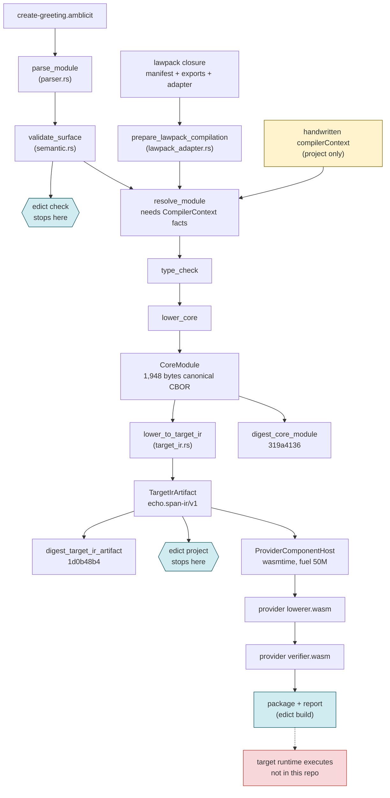
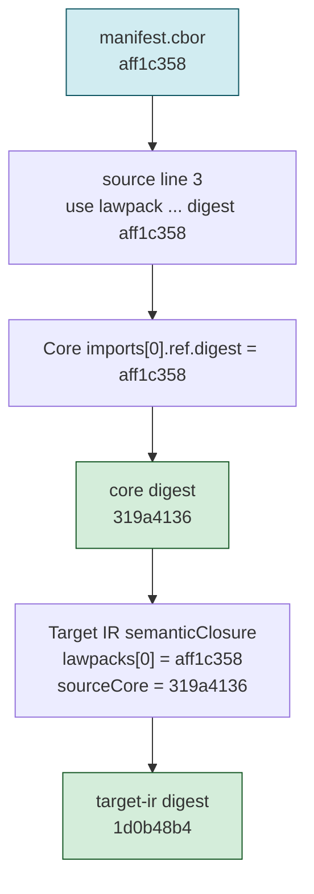

> **Ground rule for this document.** Every claim below about what Edict *does* comes
> from the Rust code in `crates/`, `xtask/`, and from running the built binary at commit
> `e4fa81dd` (2026-09-10). If a sentence here disagrees with a spec, trust the code path
> cited next to it. Where the README's claims diverge from the code is recorded
> separately, in the [Inside Edict claims audit](./audit/2026-09-10_inside-edict-claims-audit.md).
>
> **This is a dated snapshot.** Every output, byte count, digest, and line count below
> was recorded at `e4fa81dd` and is not regenerated from the fixtures. Later commits
> changed the `hello-echo` fixtures, so the digests at `HEAD` differ from the ones shown
> here; the mechanism this page describes is the same. For current values, run
> `cargo xtask lawpack-goldens --check` and read the `.sha256` files in
> `fixtures/lawpack/hello-echo/`, which are the authoritative evidence.

## 1. Orient in sixty seconds

Edict is a small, restricted language for writing *operations* (things like "create a
greeting record") in a way that a compiler can prove bounded: every operation declares
what authority it needs, what budget it may spend, and which failure it maps to, and
the compiler refuses anything it cannot pin to an explicit fact. On the `build` path
those facts are derived from a digest-locked lawpack; `project` instead accepts them
as a handwritten, unauthenticated `compilerContext` (section 4.1). The
toolchain in this repo takes an `.edict` source file, turns it into a canonical binary
form called **Core IR**, lowers that into a target-specific **Target IR**, and computes
a SHA-256 identity for each layer so that every downstream consumer can verify it got
exactly the bytes the compiler produced. That is the whole arc: source → Core →
Target IR → digests, with a sandboxed hand-off to an external "provider" at the end.

Why it matters: the README's pitch is that a function's *declared* authority and its
*actual* authority should be the same thing, enforced by a compiler rather than by
code review. This document shows how far the code has actually taken that idea, by
following one real greeting through every stage, and then shows, with numbers, where
the README is ahead of the code.

## 2. The canonical example, in full

This section puts one real input and all of its outputs on the table before any
theory, because every later section refers back to it. The input is the `hello-echo`
fixture that ships in the repo, the smallest source that crosses every stage. I ran it
through the built binary, decoded its checked-in artifacts, and recomputed its
digests independently, so what follows is what the toolchain produces today, not what
a spec says it should produce.

### 2.1 The source

The file is `fixtures/lawpack/hello-echo/create-greeting.amblicit`, reproduced exactly:

```amblicit
package examples.hello_echo@1;

use lawpack hello.echo@1 digest "sha256:aff1c3580f4b817bf3db9af8e6ca8e15ef7d57dea578b71deaf3a249f863c5af" as hello;

type GreetingCreated = {
  key: String<max=64>,
  message: String<max=256>,
};

intent createGreeting(input: hello.CreateGreetingInput) returns GreetingCreated
  profile hello.createGreeting
  basis input.basis
  budget <= hello.smallCreateBudget
{
  let receipt: hello.GreetingReceipt = hello.createGreeting(input)
    else { alreadyExists(existing) => hello.AlreadyExists };
  return {
    key: receipt.key,
    message: input.message,
  };
}
```

Read it as a contract, not as a program. Four things are declared up front and none
of them can be omitted: the **lawpack** it imports (a bundle of types, effects, and
budgets, pinned by SHA-256 digest; the digest detects substitution but there is no
publisher signature), the operation **profile** it runs under, the **basis**
(the fact the operation is conditioned on), and the **budget** ceiling. The body does
one effectful thing, `hello.createGreeting`, names the one failure it can absorb, and
returns a record whose two fields are bounded strings. Hold onto the digest on line 3;
it reappears in every artifact below.

### 2.2 Output one: the front-end check

The CLI reads JSON Lines on standard input and emits only JSON Lines. Sending the source
under a `check` settings record produces:

```json
{"command":"check","input":{"kind":"source","name":"create-greeting.amblicit"},"schema":"edict.cli.check-result/v1","status":"ok","type":"checkResult"}
{"checked":1,"command":"check","errors":0,"exitCode":0,"schema":"edict.cli.event/v1","status":"ok","type":"status"}
```

Two records, exit code 0. Note what this did *not* say: nothing about the lawpack, the
digest, the budget's value, or Core IR. The
[claims audit](./audit/2026-09-10_inside-edict-claims-audit.md) shows why that matters.

### 2.3 Output two: the Core module

The checked-in `create-greeting.core.cbor` is 1,948 bytes of canonical CBOR. Decoded
(with a twenty-line CBOR reader, no Edict code involved) and trimmed to the intent, it
reads:

```json
{
  "apiVersion": "edict.core/v1",
  "coordinate": "examples.hello_echo@1",
  "imports": [{"kind": "lawpack",
               "ref": {"id": "hello.echo@1",
                       "digest": ["sha256", "aff1c358…c5af"]}}],
  "intents": {"createGreeting": {
    "input":  "hello.echo@1.CreateGreetingInput",
    "output": "examples.hello_echo@1.GreetingCreated",
    "basis":  {"kind": "field", "field": "basis", "base": {"kind": "local", "ref": {"id": "arg.0"}}},
    "requiredOperationProfile": "continuum.profile.create/v1",
    "coreEvaluationBudget": {"maxSteps": 16, "maxOutputBytes": 512, "maxAllocatedBytes": 2048},
    "body": {"nodes": [{
      "kind": "effect",
      "effect": "hello.createGreeting",
      "input":   {"kind": "local", "ref": {"id": "arg.0"}},
      "binding": {"id": "local.0", "type": "hello.echo@1.GreetingReceipt"},
      "obstructionMap": {"alreadyExists": {
        "binder": {"id": "obstruction.0", "type": "hello.echo@1.ExistingGreeting"},
        "value":  {"kind": "call", "callee": "hello.AlreadyExists", "args": []}}}}],
      "result": {"kind": "record", "fields": {
        "key":     {"kind": "field", "field": "key",     "base": {"kind": "local", "ref": {"id": "local.0"}}},
        "message": {"kind": "field", "field": "message", "base": {"kind": "local", "ref": {"id": "arg.0"}}}}}}}}
}
```

Everything symbolic in the source has become explicit. `hello.smallCreateBudget` is
now three numbers. `profile hello.createGreeting` is now a Continuum profile
coordinate. `input.basis` is now a field access on a numbered local. The one
`else` arm is now an `obstructionMap` entry with its own typed binder. One name is
deliberately kept: the effect is still the source coordinate `hello.createGreeting`,
and Target IR lowering looks it up in the target's effect-lowering facts to choose an
intrinsic (it fails with `MissingEffectLowering` if that fact is absent). Core is
fully resolved for evaluation, not self-sufficient for target lowering.

### 2.4 Output three: the Target IR

Lowering the Core module for the `echo.dpo@1` target produces `create-greeting.target-ir.cbor`
(1,475 bytes). The interesting part is the single step and the closure block:

```json
{
  "kind": "targetIrArtifact",
  "domain": "echo.span-ir/v1",
  "targetProfile": {"id": "echo.dpo@1", "digest": ["sha256", "2e249412…fb04"]},
  "semanticClosure": {
    "lawpacks":   [{"id": "hello.echo@1",         "digest": ["sha256", "aff1c358…c5af"]}],
    "sourceCore":  {"id": "examples.hello_echo@1", "digest": ["sha256", "319a4136…0dfa"]}
  },
  "intents": {"createGreeting": {
    "steps": [{
      "id": "createGreeting.step.0",
      "effect": "hello.createGreeting",
      "targetIntrinsic": "echo.dpo@1.anchored-node-attachment-create-if-absent",
      "obstructionFailures": ["echo.executable-operation/precondition-mismatch/v1"],
      "obstructionArms": {"echo.executable-operation/precondition-mismatch/v1": {
        "value": {"kind": "call", "callee": "hello.AlreadyExists"}}}}],
    "operationProfile": "continuum.profile.create/v1",
    "coreEvaluationBudget": {"maxSteps": 16, "maxOutputBytes": 512, "maxAllocatedBytes": 2048}}}
}
```

The abstract effect `hello.createGreeting` has been bound to one concrete Echo
intrinsic, and the source-level `alreadyExists` obstruction has been bound to one
concrete Echo failure coordinate. The `semanticClosure` block carries the digest of
the lawpack *and* the digest of the Core module it was lowered from.

### 2.5 The digests

Each artifact has a sibling `.sha256` file. Here are the ones this document uses:

| Artifact | Domain | Digest (prefix) |
|---|---|---|
| lawpack `manifest.cbor` | `edict.lawpack/v1` | `aff1c358…c5af` |
| `create-greeting.core.cbor` | `edict.core.module/v1` | `319a4136…0dfa` |
| `create-greeting.target-ir.cbor` | `edict.target-ir.artifact/v1` | `1d0b48b4…d518` |
| Echo target profile | (provider-owned) | `2e249412…fb04` |

The manifest digest is the one written in the source. The Core digest is the one the
Target IR embeds. Section 4 shows the exact preimage and reproduces two of these
outside Rust.

In summary, one twenty-line source becomes a fully resolved Core module, a
target-bound Target IR, and a chain of digests where each layer names the layer
below. Everything that follows explains how, and then where the story stops.

## 3. The cast and the mental model

Before looking at how the pipeline is built, the reader needs to know who the players
are and what shape the data takes between them. There are five Rust workspace members
and four artifact shapes, and the key mental model is that there is one compiler core
with three thin entry points in front of it and one sandboxed exit behind it.

### 3.1 The crates

| Crate | Lines (src) | Role, as implemented |
|---|---|---|
| `edict-syntax` | 30,288 | The compiler. Lexer, parser, surface validation, resolver, type checker, Core lowering, canonical CBOR, Target IR lowering, plus validators for lawpacks, bundles, admission records, and provider envelopes. |
| `edict-cli` | 12,780 | The `edict` binary. JSONL request parsing, the three operations, and the two build pipelines (`lawpack_build.rs`, `application_build.rs`). |
| `edict-provider-schema` | 2,815 | CDDL-based schema registry that validates the bytes a provider component sends back. |
| `edict-provider-host-wasmtime` | 1,558 | A deliberately narrow Wasmtime host that runs provider *components* (a lowerer and a verifier) with fuel and memory limits. |
| `xtask` | 9,491 | Golden-fixture regeneration and checking, release tooling, and the `verify` umbrella. |

Two vocabulary items the table needs. A **lawpack** is a digest-pinned bundle
(manifest, exports, target adapter) that defines the types, effects, profiles, and
budgets a source may use. A **provider** is an external package for one target
(here, Echo) that ships a target profile, artifact schemas, and two WASM components:
a lowerer that turns Target IR into an executable package and a verifier that checks it.

### 3.2 The pipeline

The following diagram shows the stages as they exist in code, with the three CLI
operations as entry points and the sandboxed provider hand-off at the end. Solid
edges are calls that exist; the dashed edge is the boundary Edict does not cross.



<details>
<summary>Figure 1 - The Edict pipeline as implemented</summary>

Figure 1 traces the canonical source through the stages that exist in `edict-syntax`
and `edict-cli`. Blue nodes mark where each CLI operation stops. The yellow node is
the alternative fact source that `project` uses instead of a lawpack. The red node is
execution of the produced package, which no crate in this repo performs.

</details>

| Stage | Function (file) | What it consumes | What it proves |
|---|---|---|---|
| Parse | `parse_module` (`parser.rs`) | source text | grammar |
| Surface validate | `validate_surface` (`semantic.rs`) | AST only | bounded scalars, required clauses, no shadowing |
| Prepare | `prepare_lawpack_compilation` (`lawpack_adapter.rs`) | AST + lawpack bundle + adapter | the import digest matches the manifest; derives the fact context |
| Resolve | `resolve_module` (`compiler.rs`) | AST + `CompilerContext` | every profile, budget, effect, and type names an explicit fact |
| Type check | `type_check` | resolved module | field, binder, and obstruction types agree |
| Lower | `lower_core` | typed module | in-memory `CoreModule` |
| Canonicalize | `encode_core_module`, `digest_core_module` (`canonical.rs`) | `CoreModule` | one byte string, one identity |
| Target lower | `lower_to_target_ir` (`target_ir.rs`) | Core + target facts | every effect has one intrinsic, every obstruction one failure coordinate |
| Provider crossing | `invoke_lowerer`, `invoke_verifier` (`application_build.rs`) | Target IR + provider package | the provider's outputs are schema-valid and size-bounded |

### 3.3 The identity chain

The second structural idea is that identities nest. The source names the lawpack
digest; the Core module carries it in `imports`; the Target IR carries both the
lawpack digest and the Core digest in `semanticClosure`; the Target IR's own digest
covers all of that. The diagram makes the containment explicit.



<details>
<summary>Figure 2 - The digest chain for the canonical example</summary>

Figure 2 shows how the manifest digest written in the source propagates into the Core
module, how the Core module's own digest is then embedded in the Target IR, and how the
Target IR digest therefore commits to the whole closure. Green nodes are digests
this document reproduces independently in section 4.

</details>

| Layer | Carries | Committed to by |
|---|---|---|
| Source | manifest digest (as text) | nothing yet; `check` does not verify it |
| Core module | manifest digest (as bytes) | Core digest `319a4136…` |
| Target IR | manifest digest + Core digest + target profile digest | Target IR digest `1d0b48b4…` |

> **Intuition to carry forward:** there is one compiler core, and `check`, `project`,
> and `build` are three doors into it that stop at different depths. A claim about
> "what the compiler rejects" is only as strong as the door you walked through.

In summary, the cast is five crates around one compiler, the data is a chain of four
artifact shapes, and identity is a digest that includes the digest below it. That
model is enough to read the design intent next.

## 4. The design as built

This section walks the code path that produced the section 2 artifacts, in order, so
that when section 5 shows where the story stops, the stopping points land on a map the
reader already has. Three pieces of code carry most of the weight: the four-stage
compiler spine, the digest framing, and the application build that crosses into the
provider sandbox.

### 4.1 The compiler spine

The one-call compiler entry point is a straight line, and it is worth seeing exactly
how straight. This is `compile_to_core` in `crates/edict-syntax/src/compiler.rs`,
verbatim minus error mapping:

```rust
pub fn compile_to_core(
    module: &Module,
    context: &CompilerContext,
) -> Result<CoreModule, Vec<CompilerError>> {
    validate_surface(module).map_err(/* stage: SurfaceValidation */)?;
    let resolved = resolve_module(module, context)?;
    let typed = type_check(&resolved)?;
    lower_core(&typed)
}
```

The load-bearing argument is `context`. A `CompilerContext` is a bag of explicit
facts: which source profile names map to which Continuum profile coordinates, which
effects belong to which write class, and what numbers each budget name stands for.
`resolve_module` looks every symbolic name up in that bag and fails with
`MissingContextFact` if it is absent. There is no default context, no environment
lookup, no registry. The claims audit demonstrates this by running the canonical
source with an empty context.

The context comes from one of two places. `edict build` derives it from the lawpack
closure through `prepare_lawpack_compilation`, whose first job is the digest check in
`matching_import_alias` (`lawpack_adapter.rs`):

```rust
if import.digest.as_deref() != Some(manifest_digest.as_str()) {
    return Err(one(failure(
        LawpackAdapterFailureKind::SourceImportMismatch,
        format!("module.imports.{}.digest", import.alias),
        manifest_digest,
    )));
}
```

The string on line 3 of the source must equal the review string of the digest the
loader computed over the manifest bytes it was actually handed. `edict project`
instead accepts a handwritten `compilerContext` object in the settings record and is
explicitly barred from taking a lawpack (`validate_operation_settings` in `main.rs`
rejects `lawpack` for anything but `build`).

### 4.2 The digest frame

Every canonical artifact identity (Core module, Target IR, bundle components, and the
other canonical CBOR artifacts) is computed by one private function in `canonical.rs`,
`digest_canonical_value`. Not every identity in the repo uses it: provider component
and provider-schema identities are a plain SHA-256 of the bytes, and admission
requests use their own field-framed preimage.

```rust
let mut preimage = vec![0x83]; // canonical fixed-length array of three values
preimage.extend(encode_canonical_cbor(&text(CORE_DIGEST_FRAME))?); // "edict.digest/v1"
preimage.extend(encode_canonical_cbor(&text(domain))?);            // e.g. "edict.core.module/v1"
preimage.extend(encode_canonical_cbor(value)?);                    // the artifact itself
let hash = Sha256::digest(preimage);
```

So a digest is SHA-256 over the CBOR array `["edict.digest/v1", <domain>, <value>]`.
The frame and domain strings mean the same bytes get different identities as a Core
module and as a Target IR artifact, which prevents one artifact from impersonating
another. To confirm this is really what the goldens contain, I recomputed both
identities with a script that knows nothing about Edict:

```python
import hashlib
def txt(s):
    b = s.encode()
    return (bytes([0x60 + len(b)]) if len(b) < 24 else bytes([0x78, len(b)])) + b
core = open("fixtures/lawpack/hello-echo/create-greeting.core.cbor", "rb").read()
print(hashlib.sha256(b"\x83" + txt("edict.digest/v1") + txt("edict.core.module/v1") + core).hexdigest())
```

Output: `319a4136d0009095b516d9cbf1c6bd3b5105a43c290898a6ebc02d4713130dfa`, identical to
`create-greeting.core.sha256`. The same script with `edict.target-ir.artifact/v1` and
the Target IR bytes yields `1d0b48b4…d518`, identical to its sibling file. (The plain
`shasum -a 256` of the Core bytes is `bbf7e69a…`, which is why the frame matters.)

### 4.3 The application build

`edict build` with an `application` document is the one path that runs the whole of
Figure 1. `build_application` in `crates/edict-cli/src/application_build.rs` is 307
lines long, and its spine, in order, is:

```rust
let module = parse_module(source)?;                              // 1. parse
for lawpack in &config.lawpacks { loaded_lawpacks.push(load_lawpack(&root, lawpack)?); }
validate_application_lawpack_closure(&loaded_lawpacks)?;         // 2. lawpack closure
let provider_manifest = /* read + bind_target_provider_manifest */;
let adapter = decode_lawpack_adapter(&loaded.bundle, &config.target.profile, ...)?;
let preparation = prepare_lawpack_compilation(&module, &loaded.bundle, &adapter)?; // 3. digest check, facts
let core = compile_to_core(&module, preparation.compiler_context())?;               // 4. spine
let target_ir_report = lower_to_target_ir(&core, preparation.target_ir_facts());    // 5. target
let core_bytes = encode_core_module(&core)?;
let target_ir_bytes = encode_target_ir_artifact(&target_ir)?;                       // 6. canonical bytes
if config.build_kind == ApplicationBuildKind::ExternalAction {
    return write_external_action_outputs(&output_directory, &core_bytes, &target_ir_bytes); // early exit
}
verify_result_projection(&core, &target_ir, ...)?;                                  // 7. independent re-check
let host = ProviderComponentHost::new()?;                                           // 8. sandbox
let package_bytes = invoke_lowerer(&host, ..., &invocation)?;
let report_bytes  = invoke_verifier(&host, ..., &invocation, &package_bytes)?;
require_accepted_report(&report_bytes)?;
write_outputs(&output_directory, &package_bytes, &report_bytes)
```

Two things to notice. First, step 7 re-verifies the compiler's own result projection
from the artifacts rather than trusting the in-memory value; the build distrusts
itself. Second, both build kinds are public through the JSONL `build` request, and
`buildKind` defaults to `executableOperation`; a caller must opt into
`externalAction`, which takes the early exit in the middle of the function and is the
request-only build the README's Current Status describes. Everything after that exit,
the provider crossing, is the `ExecutableOperation` build kind. The claims audit
returns to that line.

### 4.4 The sandbox

The host that runs the provider components is configured once, in
`ProviderComponentHost::new` (`edict-provider-host-wasmtime/src/lib.rs`):

```rust
config
    .wasm_component_model(true)
    .consume_fuel(true)
    .epoch_interruption(false)
    .wasm_simd(false)
    .wasm_relaxed_simd(false)
    .relaxed_simd_deterministic(true)
    .wasm_tail_call(false)
    .wasm_memory64(false)
    .wasm_multi_memory(false)
    .cranelift_nan_canonicalization(true)
    .memory_init_cow(false)
    .max_wasm_stack(MAX_WASM_STACK_BYTES);
```

Every line is a determinism or containment choice: fuel instead of wall-clock
interruption, NaN canonicalization so floating point cannot leak platform bits, and no
optional Wasm features. `prepare` then verifies the component's digest, checks a
contract attestation section, and checks the import and export surface:
`verify_component_surface` permits only the type-only
`edict:target-provider/protocol@1.0.0` instance import and rejects any callable,
capability-bearing, or unknown import. That surface check is the authority boundary;
linking with `define_unknown_imports_as_traps` only fills in unresolved imports. Per
invocation, the CLI supplies these limits
(`host_limits()` in `application_build.rs`):

| Limit | Value |
|---|---|
| input bytes | 1 MiB |
| output bytes | 3 MiB |
| guest memory | 16 MiB |
| fuel | 50,000,000 |
| instances / memories / tables | 100 / 8 / 8 |
| host diagnostic bytes | 512 |

In summary, the design is a straight compiler spine fed only by explicit facts, one
digest frame shared by every artifact, and a build that re-checks its own output
before handing Target IR to a fuel-limited WASM component with no callable or
capability-bearing host imports. This sandbox runs the provider's build-time lowerer
and verifier; nothing in this repository executes the resulting Edict operation.

## 5. Where to go next

The natural assumption to test next is that a green `check` means all of this
happened. The [Inside Edict claims audit](./audit/2026-09-10_inside-edict-claims-audit.md)
takes that up: it runs the same canonical example through each CLI operation, records
where the README's claims run ahead of the code, explains how those gaps were
measured, and lists acceptance criteria for closing them.

---

### Appendix: reproducing this document's runs

All commands run from the repo root at `e4fa81dd` after `cargo build -p edict-cli`.

```sh
# section 2.2: check the canonical source
S=$(jq -Rs . < fixtures/lawpack/hello-echo/create-greeting.amblicit)
printf '%s\n%s\n' \
  '{"schema":"edict.compiler.settings/v1","type":"compilerSettings","operation":"check"}' \
  "{\"schema\":\"edict.compiler.input/v1\",\"type\":\"compilerInput\",\"kind\":\"source\",\"name\":\"create-greeting.amblicit\",\"source\":$S}" \
  | ./target/debug/edict

# section 2.5 and 4.2: reproduce the goldens with the real toolchain
cargo xtask lawpack-goldens --check
```

