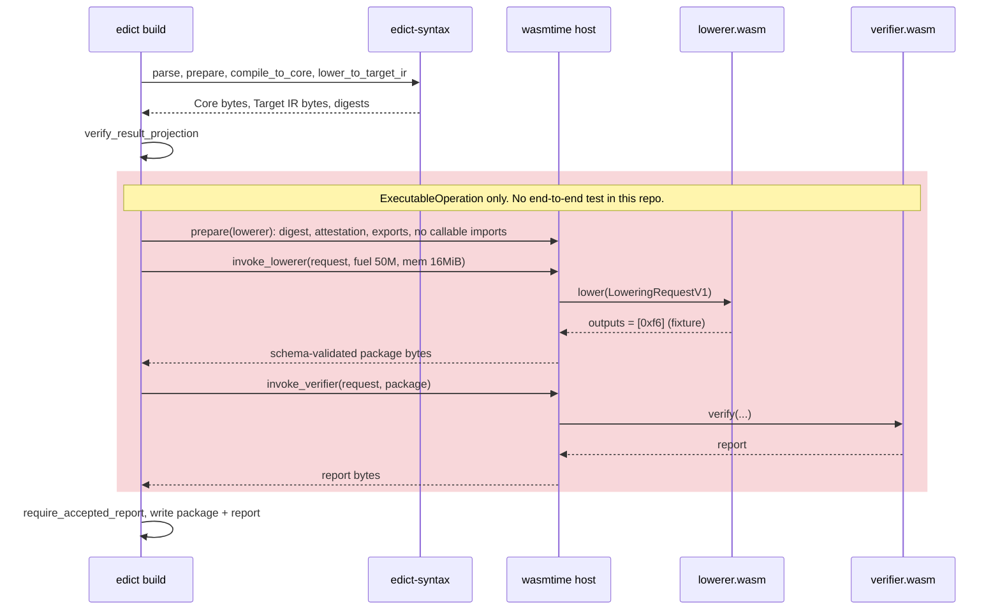
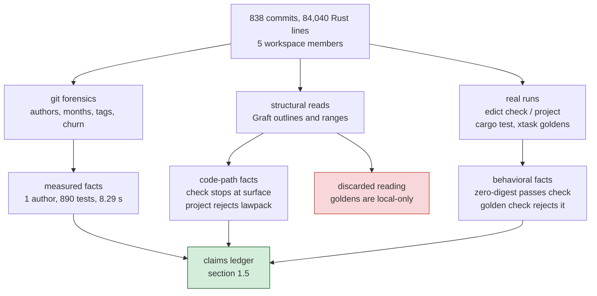
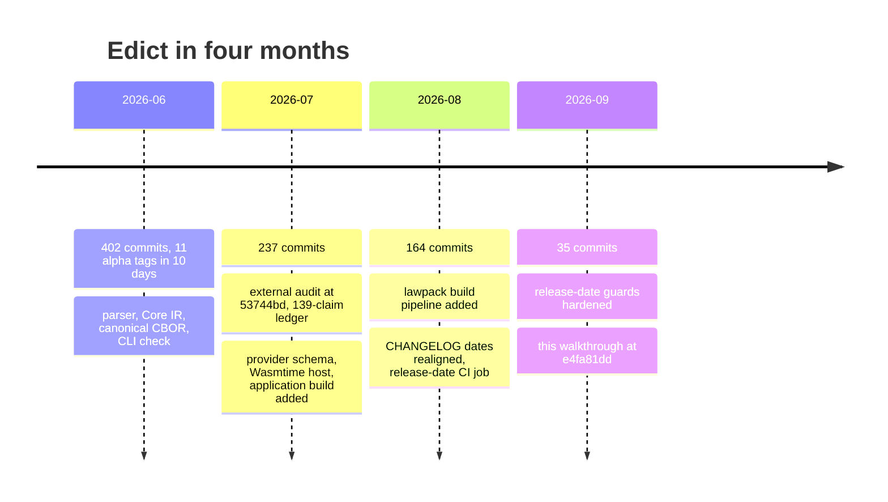

> **Scope and date.** This is a point-in-time audit of commit `e4fa81dd` (2026-09-10).
> Every count, output, and verdict below was recorded at that commit and is not
> regenerated; later commits may have closed or changed any gap listed here. It assumes
> the pipeline model, canonical example, and section numbering of the
> [Inside Edict explainer](../EXPLAINER_inside-edict.md); read that first.

## 1. Where reality diverges from the claims

This section is the audit's core: a portfolio of places where the README, the CLI's
own surface, or the test suite claims more than the code delivers, each paired with
the code path or command that establishes what actually happens. None of these is a
crash. They are gaps between the promise and the mechanism, which is exactly the kind
of gap Edict exists to close in *other* people's code.

### 1.1 Foil one: `check` says ok to a broken lock

The false-positive foil. Replace the digest on line 3 of the canonical source with
sixty-four zeros and run `check`:

```json
{"command":"check","input":{"kind":"source","name":"create-greeting.edict"},"schema":"edict.cli.check-result/v1","status":"ok","type":"checkResult"}
{"checked":1,"command":"check","errors":0,"exitCode":0,"schema":"edict.cli.event/v1","status":"ok","type":"status"}
```

Exit 0, identical to the untampered run. This is by design, not by accident: `check`
in `lib.rs` is documented as "parse and surface-validate" and "does not resolve
imports". The digest is only compared in `prepare_lawpack_compilation`, which `build`
and the xtask golden check run. Doing the same tamper to the fixture and running
`cargo xtask lawpack-goldens --check` gives:

```text
xtask: fixtures/lawpack/hello-echo/create-greeting.edict: expected exactly one import pinned to sha256:aff1c3580f4b817bf3db9af8e6ca8e15ef7d57dea578b71deaf3a249f863c5af
```

So the lock holds, one door deeper. The gap is that the CLI's only source-level
operation whose name suggests "verify this" does not touch the lock.

### 1.2 Foil two: what the front end does reject

The negative foil, so the boundary is drawn from both sides. Two single-line edits to
the canonical source, each run through `check`:

| Edit | Diagnostic | Exit |
|---|---|---|
| `key: String<max=64>` becomes `key: String` | `{"kind":"UnboundedScalar","stage":"semantic","span":{"start":176,"end":187}}` | 1 |
| delete the `budget <= …` line | `{"kind":"MissingBudget","stage":"semantic","span":{"start":229,"end":558}}` | 1 |

Bounded strings and mandatory budgets are surface rules, so `check` enforces them with
byte-accurate spans. The front end is strict about *shape*; it is silent about
*facts*.

### 1.3 `project` needs facts it cannot get from a lawpack

Running the canonical source through `project` with `emit: ["core","targetIr","digests"]`
and no `compilerContext` yields, for both the Core and Target IR records:

```json
{"schema":"edict.projection.core/v1","type":"core","state":"blocked",
 "reason":[{"kind":"MissingContextFact","stage":"resolve","span":{"start":229,"end":593}}, …]}
{"checked":1,"command":"project","errors":2,"exitCode":0,"schema":"edict.cli.event/v1","status":"ok","type":"status"}
```

Two findings live in this output. The good one: span 229 to 593 is the whole intent,
and the compiler refuses to invent a profile or budget for it, which is the
no-ambient-authority rule working. The status record reports `errors: 2` and
`exitCode: 0`; this is the documented contract, not a defect. `CLI-REQ-014` treats
compiler-level projection failures as projection data, and `CLI-TP-020` pins exit 0
so editor adapters can tell a bad buffer from a broken CLI transport. The July audit
read it as a gap; the contract says otherwise. The real gap is
structural: `project` cannot be given the lawpack that would supply those facts, so
the canonical example cannot be projected to Core through the CLI at all; only
`build` and xtask can compile it.

### 1.4 The only lowerer in the repo returns `null`

The provider crossing in [explainer section 4.3](../EXPLAINER_inside-edict.md#43-the-application-build) is real code with real limits, and the repo ships
`fixtures/providers/components/lowerer.component.wasm` to exercise it. Its source is a
fixture guest whose default branch is:

```rust
fn valid(request: LoweringRequestV1) -> LoweringResultV1 {
    Ok(LoweringSuccessV1 {
        outputs: request.requested_outputs.into_iter().map(|output| LoweringOutputArtifact {
            role: output.role, kind: output.kind,
            artifact: Artifact { domain: output.domain, bytes: vec![0xf6] },
            logical_path: None,
        }).collect(),
        diagnostics: Vec::new(),
    })
}
```

The artifact it emits is one byte, `0xf6`, which is CBOR `null`. The other branches
spin forever, trap, allocate 128 MiB, flood output, or return malformed envelopes,
which is exactly what a host test suite needs. But it means the sequence below is
proven end-to-end only against a stub, and the `ExecutableOperation` build kind that
drives it has no end-to-end test in `edict-cli` at all: every application build test
in `application_build.rs` and `lawpack_authoring_cli.rs` uses `buildKind:
"externalAction"`, which exits before the host is constructed.



<details>
<summary>Figure 3 - The provider crossing for one build</summary>

Figure 3 shows the order of calls in `build_application` after the compiler stages.
The shaded region is the part that only runs for the `ExecutableOperation` build kind
and that, in this repo, has only the fixture lowerer to talk to. The real Echo lowerer
lives in the Echo repository.

</details>

| Step | Where | Tested in this repo by |
|---|---|---|
| compile and lower | `edict-syntax` | 600 tests incl. hello-echo goldens |
| verify result projection | `application_build.rs` | unit tests in the same file |
| host prepare and invoke | `edict-provider-host-wasmtime` | 29 tests against fixture components |
| whole `ExecutableOperation` build | `build_application` after the early exit | nothing |

### 1.5 The claims ledger

The remaining gaps are best read as a table: the claim as written, and the executable
evidence. Line numbers refer to `README.md` at `e4fa81dd`; hit counts are
`grep -rni` over `crates/*/src`.

| Claim (README) | Line | Measured reality |
|---|---|---|
| "If an operation tries to access unauthorized state, mutate a forbidden table, or exceed its execution budget, it fails to compile." | 5 | True only against explicitly supplied facts. With none, the result is `blocked`, reported as projection data with exit 0 by contract (section 1.3). |
| "WASM Sandbox (Enforced limits & auto-rollback)" in the four-stage diagram, and the banner "the WASM sandbox are not implemented yet" | 13, 22 | The diagram's runtime "Execute Safely" sandbox does not exist, so the banner is accurate about it. A different, build-time sandbox exists ([explainer section 4.4](../EXPLAINER_inside-edict.md#44-the-sandbox)): it runs the *provider's* lowerer and verifier and never executes an Edict operation. "rollback" has 63 hits, all filesystem publication rollback in the build modules. |
| "Every contract bundle carries … a nutrition label … The compiler produced it" | 287 to 306 | `nutrition`: 0 hits. |
| "HOLMES takes the complete, SHA-locked bundle and evaluates every invariant" | 314 to 318 | 3 hits: an `AssuranceRole::Holmes` enum variant and its string. `certificate`: 0 hits. The `edict-syntax` crate doc says it "does not execute those tools". |
| `reveal entry;` shown as source syntax | 432 | 0 hits. The parser's keyword set has no `reveal`. |
| "Compiler CLI workflows beyond JSONL `check`" listed under what does not exist | Current Status | The CLI has three operations: `check`, `project`, `build` (`main.rs` constants). This status line is stale in the code's favor. |
| "Public request-only application builds … without provider-component invocation" | Current Status | Accurate, and the only build kind with end-to-end coverage (section 1.4). |

Two entries deserve a sentence. The Current Status line about CLI workflows
undersells the code, which is the rare direction for this README; the sandbox banner
does not, because the provider sandbox that exists is not the runtime sandbox the
diagram describes. The nutrition-label and HOLMES paragraphs
are written in the present tense about machinery that has no implementation beyond an
enum. The July audit flagged all of these; at `e4fa81dd`, only the CHANGELOG dates
have been corrected.

In summary, the lock is real one door deeper than `check`, the provider sandbox is
real but has only a stub to run and is not a runtime sandbox, `project` cannot reach
the canonical example, and the README's narrative sections describe a system about two layers ahead
of the one that compiles. The next section shows how those statements were established
and which of my own first readings were wrong.

## 2. How it was measured

The gaps above are only as trustworthy as the method that found them, so this section
lays out the evidence sources, the counts, and the dead ends, including two places
where an earlier reading (mine, and the July audit's) turned out to be wrong. The
method combined three kinds of evidence: running the built binary on the canonical
example, reading the code structurally with Graft's outline and range tools, and git
and test forensics over the repository.

### 2.1 Evidence funnel

The three streams start from the same raw material and answer different questions,
and the diagram below shows which stream produced which kind of fact, including the
one reading that did not survive.



<details>
<summary>Figure 4 - From repository to ledger</summary>

Figure 4 shows the three evidence streams and where they converge. The red node is a
claim inherited from the July audit that this pass overturned in part; section 2.4
explains it.

</details>

| Stream | Commands | What it can and cannot establish |
|---|---|---|
| git forensics | `git rev-list --count`, `git shortlog -sn`, `git for-each-ref refs/tags`, `git log --name-only` | who, when, how often; nothing about behavior |
| structural reads | Graft `file_outline`, `read_range`, `code_show` | what a path *can* do; not what it does on a given input |
| real runs | `./target/debug/edict < request.jsonl`, `cargo test --workspace --offline`, `cargo xtask lawpack-goldens --check` | what happens on the canonical input; only for the inputs tried |

### 2.2 Repository forensics

| Measure | Value |
|---|---|
| Commits on the `HEAD` lineage | 838 (727 non-merge) |
| Authors | 1 (100% of commits) |
| First and last commit | 2026-06-17 to 2026-09-07 |
| Commits per month | June 402, July 237, August 164, September 35 |
| Release tags | 11, all `-alpha.1`, all cut between 2026-06-21 and 2026-06-30 UTC |
| Rust lines | 56,932 source, 27,108 tests |
| Lockfile packages | 169 distinct (32 Wasm or Cranelift related) |
| Direct deps of `edict-syntax` | `serde`, `serde_json`, `sha2` |
| Longest function | `parser.rs::let_rhs`, 493 lines |
| Most-touched source file | `xtask/src/main.rs`, 99 commits; `compiler.rs` second at 66 |

Two of those numbers shape the rest. The single author is the audit's only critical
finding and it has not moved. The lockfile grew from 29 packages in July to 169 now,
almost entirely from adding Wasmtime; the compiler crate itself still has three
dependencies.

### 2.3 Test and CI evidence

`cargo test --workspace --offline` on a warm build: 890 passed, 0 failed, 1 ignored,
across 47 binaries, in 8.29 seconds of wall time. Per crate: `edict-syntax` 600,
`edict-cli` 136, `edict-provider-schema` 32, host 29 plus the one ignored replay
child, `xtask` 88. Five doctests, all in `edict-syntax`.

CI (`.github/workflows/ci.yml`) runs `cargo fmt --check`, `cargo clippy` with warnings
denied, `cargo test --workspace --all-features` on Rust 1.94.0 and stable, one Windows
containment test, `cargo deny`, and two xtask checks: `provider-component-fixtures
--check` and `release-dates --check`. It does not run `cargo xtask verify`,
`contract-check`, any of the seven `*-goldens --check` commands, `cargo doc`, or any
fuzzer. There is no `fuzz/` directory, no project-owned fuzz target, and no direct
`proptest`, `quickcheck`, or `arbitrary` dependency in any workspace member; the three
grep hits for "arbitrary" under `crates/` are English words in doc comments. The
resolved dependency graph does contain `arbitrary` 1.4.2, transitively through
`cranelift-codegen`, which does not give Edict a fuzz target.

### 2.4 Dead ends and corrections

These are kept because each one changed a sentence in section 1.

- **"Goldens are local-only" is half wrong.** The July audit reported that golden
  checks live only in xtask. Re-checking, `crates/edict-syntax/tests/lawpack.rs`
  embeds the hello-echo source, Core bytes, Target IR bytes, and both `.sha256` files
  with `include_bytes!` and asserts the compiler reproduces them, and `golden_cli.rs`
  replays every `fixtures/cli/` case. Both run under `cargo test`, which CI runs. What
  CI still lacks is the xtask *regenerate-and-diff* loop and `contract-check`. The
  ledger entry was narrowed accordingly.
- **The canonical example cannot go through `project`.** My first plan was to show
  `project` emitting Core and digests for `create-greeting.edict`. It cannot: the
  lawpack setting is build-only, and the projection context has no slot for lawpack
  types. That failure became section 1.3 instead of a footnote.
- **Grepping for command names found nothing.** The CLI's operations are `const`
  strings, not literal `"edict.…"` schema names, so the first search for the command
  surface returned empty. Reading `main.rs` structurally through its outline found the
  three constants in the first 40 lines.
- **The README banner is not stale.** I first read "WASM sandbox not implemented" as
  stale because a Wasmtime host exists. It is not the same sandbox: the banner and the
  diagram describe runtime execution of Edict operations, while the host runs build-time
  provider components. The ledger entry keeps the two apart.

> **Intuition to carry forward:** a claims audit of a compiler should be run against
> one real input at every door, because the doors stop at different depths and a
> grep cannot tell you which one a sentence was written about.

In summary, three evidence streams converge on the ledger, the numbers are the ones
the commands print, and two inherited readings were corrected rather than smoothed
over.

## 3. What mature looks like

The audit is not a bug report with a fix; it is a distance measurement. This closing
section states where the repo is on the July report card, which of its ten headline
findings have moved, and what acceptance criteria would make each section 1 gap
disappear, so that "mature" is a checklist rather than a mood. The chronology first,
because the shape of the effort explains the shape of the gaps.



<details>
<summary>Figure 5 - Chronology of the repository</summary>

Figure 5 places the July audit and this document on the commit timeline. The June
burst produced the compiler; the later months produced the provider crossing and the
release hygiene, which is why the front half is the best-tested half.

</details>

### 3.1 Report card and movement since July

The July audit graded ten vectors. Where this pass has evidence, the movement is noted.

| Vector | July grade | Movement at `e4fa81dd` |
|---|---|---|
| Architecture and code quality | A− | Two crates and the provider crossing added; five functions over 150 lines now |
| Test quality | A− | 367 to 890 tests, still 0 failures; still no fuzzing |
| Documentation | B+ | CHANGELOG dates fixed; README narrative sections unchanged |
| Ecosystem and hygiene | B+ | `cargo deny` and release-date checks in CI; goldens loop still local |
| Security and supply chain | A− | Wasmtime pinned at 46.0.3 after two advisories; lockfile 29 to 169 |
| Bus factor | D | 838 of 838 commits by one author |
| Recommendation, use | Not yet | Unchanged: nothing executes an operation |

### 3.2 Acceptance criteria

Each item closes one gap named in section 1 or 2. The list is ordered by how much of
the README it would make true.

- [ ] **A non-stub lowerer completes an `ExecutableOperation` build in CI.** The
      real Echo provider lowers the hello-echo Target IR, the verifier accepts it, and a
      test asserts the package bytes are not `0xf6`. This turns Figure 3's shaded region
      from proven-against-a-stub into proven.
- [ ] **`project` either accepts a lawpack or is documented as a review surface,
      not a gate**, so the canonical example can be projected through the CLI. Its exit
      0 on compiler-level errors is a deliberate contract (`CLI-REQ-014`) and is not
      part of this criterion.
- [ ] **`cargo xtask verify` runs in CI**, so the golden regenerate-and-diff loop and
      `contract-check` cannot drift from what `cargo test` embeds.
- [ ] **A fuzz target exists for `parse_module`**, given `let_rhs` at 493 lines and a
      threat model that stakes itself on not panicking on malformed input.
- [ ] **The README's narrative sections match the ledger**: the diagram and banner
      distinguish the build-time provider sandbox from the unimplemented runtime
      sandbox, the nutrition-label and HOLMES paragraphs move to future
      tense or to the roadmap, `reveal` is removed, and Current Status lists three CLI
      operations.
- [ ] **A second committer lands a non-trivial change**, moving the one grade the
      code cannot fix by itself.

Done, for this document's purposes, is the first three boxes: at that point the
canonical greeting would go from source to an accepted provider package with every
step tested where it runs, and `check`, `project`, and `build` would each be honest
about how deep they went.

In summary, the compiler half of Edict is built, tested, and reproducible down to the
byte, as [the explainer](../EXPLAINER_inside-edict.md) showed; the hand-off half is built and sandboxed but only ever
proven against a fixture that returns `null`; and the README describes the system that
will exist when the first checkbox above is ticked.

---

### Appendix: reproducing this document's runs

All commands run from the repo root at `e4fa81dd` after `cargo build -p edict-cli`.

```sh
# section 1.1: check the canonical source (swap the digest for zeros for the foil)
S=$(jq -Rs . < fixtures/lawpack/hello-echo/create-greeting.edict)
printf '%s\n%s\n' \
  '{"schema":"edict.compiler.settings/v1","type":"compilerSettings","operation":"check"}' \
  "{\"schema\":\"edict.compiler.input/v1\",\"type\":\"compilerInput\",\"kind\":\"source\",\"name\":\"create-greeting.edict\",\"source\":$S}" \
  | ./target/debug/edict

# section 1.1 (golden check): reproduce the goldens with the real toolchain
cargo xtask lawpack-goldens --check

# section 1.3: project without facts
# same input record, settings: {"operation":"project","emit":["core","targetIr","digests"],
#   "target":{"coordinate":"echo.dpo@1","profileDigest":"sha256:<64 hex>","irDomain":"echo.span-ir/v1"}}

# section 2.3
cargo test --workspace --offline
```
