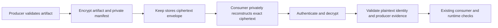

# Proposal: End-to-end encrypted Edict artifacts

This proposal defines an optional confidential-artifact mode. The compiler endpoint encrypts before storage. Only authorized consumer endpoints can decrypt. The storage service does not receive plaintext or decryption keys.

## 1. Background Context

Build artifacts can reveal source logic, business rules, or private build metadata. Exact storage identity protects byte integrity. It does not establish confidentiality, producer trust, or execution authority.

Keep can store an opaque ciphertext object under its ordinary content identity. This proposal does not assume that Keep already implements encryption. The encryption boundary belongs to Edict's build/export layer and the authorized consumer's artifact loader.

| Relationship | Targets |
| --- | --- |
| refines | [Artifact identity contract](https://github.com/flyingrobots/edict/blob/618aa4f84ff88a0873849f8d9cfa55e1f340ffb9/docs/topics/contract-bundles/README.md), [Rust I/O boundary](https://github.com/flyingrobots/edict/blob/618aa4f84ff88a0873849f8d9cfa55e1f340ffb9/docs/topics/rust-standards/README.md#io-boundaries) |
| supersedes | none |
| depends_on | The generic artifact interface and private retrieval boundary in [artifact-store slice A1](keep-build-artifacts.md#7-definition-of-done); no concrete Keep backend prerequisite |
| related_to | [Keep artifact-store proposal](keep-build-artifacts.md), [admission contract](https://github.com/flyingrobots/edict/blob/618aa4f84ff88a0873849f8d9cfa55e1f340ffb9/docs/topics/admission/README.md), [provider boundary](https://github.com/flyingrobots/edict/blob/618aa4f84ff88a0873849f8d9cfa55e1f340ffb9/docs/topics/providers/README.md) |

## 2. Problem Description

An artifact can remain confidential in transit yet expose its contents in a build cache, backup, temporary file, or remote storage service. Disk encryption alone does not establish that the storage operator cannot read an artifact.

An optional end-to-end mode should preserve artifact validation while restricting plaintext access to its declared endpoints.

## 2b. Proposed Solution

### Threat model and endpoints

The proposal protects artifact contents from storage operators, storage replicas, and parties that obtain ciphertext without the required keys. It also requires explicit tamper and substitution refusal.

The producer endpoint and authorized consumer see plaintext. This mode does not protect a compromised endpoint or erase plaintext that a recipient already copied. Source repositories, process memory, swap, traffic analysis, and physical secure deletion need separate policies. Public object size and timing may remain observable.

A recipient's decryption permission does not make that recipient a trusted compiler or an authorized runtime caller. Producer evidence and runtime admission remain separate checks.

### Envelope and identities

Use a reviewed authenticated-encryption library and a versioned, strictly decoded envelope. Freeze the suite, key-wrap method, nonce rules, and compatibility policy before implementation. Do not design a new cipher.

The public envelope carries only the approved version, suite identifier, key-routing information, framing, and ciphertext. Associated data must bind the public header and object context. Associated data is authenticated but remains visible. Nonce handling must satisfy the selected suite's requirements. [RFC 5116](https://www.rfc-editor.org/rfc/rfc5116.html)

The private payload contains the artifact bytes, exact plaintext byte binding, artifact role, native Edict reference, build-input manifest, and producer evidence. An exact byte binding is necessary when a native identity intentionally normalizes representation.

Keep's stored `BlobId` names the ciphertext envelope. Edict's existing artifact identities continue to describe their own plaintext preimages. The loader must verify both. Never substitute the ciphertext identity for an existing Edict digest.

The table states proposed ownership. It does not freeze field names or serialization.

| Data | Visibility and owner |
| --- | --- |
| Ciphertext object identity and public framing | Storage-visible; the storage adapter validates exact bytes. |
| Plaintext artifact and exact byte binding | Encrypted; authorized endpoints validate them. |
| Native Edict reference and complete input manifest | Private by default; the consumer checks their existing contracts. |
| Producer evidence | The trusted producer authenticates it; possession of a decryption key is insufficient. |
| Cache lookup identifier | Realm-scoped and keyed, or confined to a trusted index; no public plaintext-hash lookup by default. |
| Recipient keys and recovery material | Endpoint/key-management boundary; never stored as plaintext beside the object. |

Public plaintext hashes can reveal equality or support guesses about known artifacts. The confidential mode must define metadata disclosure, not encrypt only the large payload.

### Export, retrieval, and plaintext handling

Select confidential mode before artifact publication. A missing key or unsupported suite refuses that export. It does not fall back to a plaintext artifact.

The build layer encrypts validated bytes in bounded memory or another explicitly admitted private facility. It must not first publish the legacy plaintext output and then encrypt a copy. Existing ordinary builds retain their current format and behavior.

Keep stores the complete ciphertext envelope. The adapter establishes its declared retention contract before it publishes a retrievable encrypted manifest or reference.

The consumer reconstructs ciphertext into private bounded storage, checks storage identity, and validates envelope framing. It authenticates decryption, checks the exact plaintext binding, and performs the existing artifact and producer checks. Only then does it release the artifact to the next authorized validation stage. Runtime admission still occurs separately.

For the first version, authenticate the complete envelope before exposing plaintext. Streaming decryption may otherwise expose a prefix before the final tag succeeds. A future chunked format needs independent rules for order, total length, truncation, and final completion.

This flow keeps the storage service outside the plaintext boundary.

Caption: Confidential storage and authorized endpoints

1. The producer encrypts before it publishes the storage object.
2. Keep authenticates ciphertext storage without receiving decryption keys.
3. The consumer keeps reconstruction and decryption private until checks pass.
4. Successful decryption does not skip artifact validation or runtime admission.

The endpoints define the confidentiality boundary. Storage integrity, cryptographic authentication, producer trust, and execution authority remain distinct obligations.

### Keys, cache reuse, and operational policy

The proposed design uses an artifact data-encryption key and an established recipient-wrapping mechanism. Separate encryption, producer-authentication, and cache-index purposes. Exact algorithms and key-service choices remain open decisions.

Define recipient enrollment, rotation, recovery, backup, and loss handling. Revocation can restrict future key access. It cannot retract plaintext or keys already copied by an authorized recipient.

Use fresh suite-compliant encryption parameters for each new encryption. Reuse an existing admitted ciphertext object when its recipient and policy context still applies. Independently encrypted copies generally lose content-level deduplication. Deterministic or convergent encryption is outside the first proposal and requires a separate leakage review.

Prevent secret contents, plaintext hashes, and source paths from entering persistent diagnostics or remote logs by default. Any authorized local plaintext reveal needs a separate explicit operation. Do not claim that deleting a retention root securely deletes physical media.

## 2c. Alternatives considered and rejected

| Option | Assessment |
| --- | --- |
| Host disk encryption only | Useful for a local device threat model; does not satisfy storage-service blindness. |
| Storage service holds decryption keys | Does not meet the proposed endpoint boundary. |
| Encrypt after publishing ordinary outputs | Reject. A plaintext artifact already exists outside the confidential export contract. |
| Encrypt payload but leave private manifests public | Reject as the default. Build identities and lookup metadata can disclose sensitive information. |
| Preserve global deduplication with deterministic encryption | Defer. Equality and guessing leakage need a separate security decision. |

## 2d. Acceptance Criteria

All criteria are planned. No encrypted Edict artifact implementation or security certification is claimed.

| Requirement | Planned observable result |
| --- | --- |
| EA-01: Endpoint confidentiality | Keep and the transport path receive only approved public metadata and ciphertext. |
| EA-02: Exact recovery | An authorized consumer recovers the exact original artifact and preserves its native Edict identity. |
| EA-03: Refusal before release | Wrong keys, altered headers, ciphertext changes, truncation, wrong artifact role, and cross-realm substitution release no plaintext artifact. |
| EA-04: Producer trust | A recipient that can create valid ciphertext cannot impersonate an authorized producer or obtain runtime authority. |
| EA-05: No plaintext fallback | Missing keys and unsupported modes produce a stable structured refusal without ordinary output publication. |
| EA-06: Metadata policy | Private build inputs, native digests, source paths, and secret markers remain outside public indexes and persistent logs. |
| EA-07: Resource bounds | Oversized envelopes and plaintext exceedance refuse within declared allocation, storage, and time budgets. |
| EA-08: Key lifecycle | Rotation, recovery, unavailable key services, and future-access revocation have explicit tested outcomes. |
| EA-09: Compatibility | Ordinary artifact bytes, digest domains, and consumers remain unchanged when confidential mode is disabled. |

## 2e. Test Plan

Use existing exact artifact fixtures with test-only keys and a vetted suite's published vectors. Verify plaintext and ciphertext identities independently. Exercise cryptographic refusal after storage identity succeeds, rather than counting only a failed storage hash as an encryption test.

Use malicious manifests, wrong producer evidence, failing output sinks, and interrupted export/retrieval. Inspect owned public outputs, indexes, diagnostics, and log artifacts for deliberately injected secret markers. Bound the confidentiality claim to those paths; a marker scan is not a proof against all side channels.

Use deterministic nonce inputs only in test vectors. Production nonce generation must obey the accepted suite contract. Run RED/GREEN before behavioral changes and the full local gate on stable candidates. Reuse the same 20 GiB build, 4 GiB data, and 128 MiB log budgets. Stop owned child processes when a guard or deadline fails.

## 3. Prerequisites

- Define the threat model, authorized endpoints, approved public metadata, and producer-trust policy.
- Complete artifact interface slice A1, including private retrieval and trusted input/output association. The concrete Keep adapter is optional.
- Select and review a maintained encryption and recipient-wrapping implementation. Record dependency and platform impact.
- Freeze a strict envelope, exact plaintext binding, suite/nonce policy, error vocabulary, and bounded release mechanism.
- Specify key recovery, confidentiality-safe diagnostics, and caller behavior after refusal.

## 4. Scope

In: optional confidential export and retrieval, encrypted private manifests, exact identity preservation, key/recipient policy, bounded decryption, and refusal evidence.

Out: new ciphers, secure enclaves, endpoint-compromise protection, source-repository encryption, complete traffic-analysis protection, physical secure deletion, and changes to Edict semantics or runtime authority.

## 5. Why now

The user proposed end-to-end protection for artifacts stored by Keep. This design makes that goal explicit before storage integration creates plaintext cache or metadata assumptions.

## 6. Risks

Key loss can make retained artifacts unreadable. Recipient key access can persist after revocation. Plaintext spill and public lookup metadata can defeat a narrow payload-only design. Crypto misuse, unbounded decryption, and accidental bypass of existing validators remain distinct implementation risks.

Measure the operational cost before adoption. No throughput, deduplication ratio, total-memory bound, or universal confidentiality claim exists from this proposal.

## 7. Definition of Done

Proposal completion means the threat model, ownership, alternatives, prerequisites, and acceptance gates are reviewable. Implementation completion requires evidence for every accepted requirement and a reviewed rollout. Confidential mode must remain disabled until those gates pass.

Execute future work in this order:

1. **B1: Envelope and policy contract.** Freeze the suite, endpoint model, exact byte binding, producer evidence, and metadata policy. Requires A1's artifact interface.
2. **B2: Confidential export.** Encrypt before any public artifact output and refuse missing keys without plaintext fallback. Depends on B1.
3. **B3: Authorized consumer retrieval.** Authenticate and validate privately before release. Depends on B2's stable envelope; ordinary consumers remain intact.
4. **B4: Key lifecycle and disclosure controls.** Prove recovery, rotation, recipient policy, index privacy, and safe diagnostics. Depends on B2/B3. Confidential mode remains disabled for general use.
5. **B5: Adoption decision.** Run the accepted end-to-end matrix and review its precise limits before enabling any deployment. Depends on B4.

Each slice must build and pass its required checks. B2 and B3 first supply internal, disabled machinery with independent executable evidence. No public confidential-export route activates before the complete producer/consumer and disclosure gates pass. A disabled flag does not excuse incorrect behavior within a slice.

These are proposed independently mergeable slices, not existing tracker issues or permission to implement them.

## 8. Stakeholders

James decides the confidentiality requirement. Edict maintainers own producer/export behavior and artifact contracts. Consumers own trusted loading and runtime admission. Key-management operators own recipient and recovery policy. Keep owns ciphertext storage evidence.

## 9. Related Issues

The [Keep artifact-store proposal](keep-build-artifacts.md) supplies the generic storage boundary. Echo Keep adoption remains separate. No confirmed author-study flaw requires artifact encryption as its repair.

### Sources

- Edict `618aa4f84ff88a0873849f8d9cfa55e1f340ffb9`: [artifact identity and evidence](https://github.com/flyingrobots/edict/blob/618aa4f84ff88a0873849f8d9cfa55e1f340ffb9/docs/topics/contract-bundles/README.md), [admission](https://github.com/flyingrobots/edict/blob/618aa4f84ff88a0873849f8d9cfa55e1f340ffb9/docs/topics/admission/README.md), and [Rust I/O boundary](https://github.com/flyingrobots/edict/blob/618aa4f84ff88a0873849f8d9cfa55e1f340ffb9/docs/topics/rust-standards/README.md#L78).
- Keep `3165890e9291cfb5fe10e81a9d7cd151f3e59464`: [authenticated reconstruction and output visibility](https://github.com/flyingrobots/keep/blob/3165890e9291cfb5fe10e81a9d7cd151f3e59464/docs/invariants/authenticated-reconstruction/README.md), [current storage scope](https://github.com/flyingrobots/keep/blob/3165890e9291cfb5fe10e81a9d7cd151f3e59464/README.md).
- [RFC 5116](https://www.rfc-editor.org/rfc/rfc5116.html): authenticated encryption, associated-data visibility, decryption refusal, and nonce requirements. The proposal does not select a suite merely by citing this RFC.
