# Proposal: Keep for Edict build artifacts

This proposal asks whether Edict should use Keep as an optional artifact store and build cache. It does not change the compiler or enable a storage backend.

## 1. Background Context

Edict currently publishes application outputs through its filesystem build layer. Its library compiler paths use explicit inputs and must not perform hidden storage discovery. Keep supplies content identities and authenticated reconstruction. Its current durable reader requires an admitted, writable, case-sensitive Linux ext4 environment. These are source observations, not a new integration test. [Sources 1–3](#sources)

Echo has its own physical-content interface. Its main branch has no Keep backend adapter at the cited revision. An Edict artifact store would be a separate consumer of Keep. Echo backend adoption is not its implementation prerequisite. [Source 4](#sources)

| Relationship | Targets |
| --- | --- |
| refines | [CLI build boundary](https://github.com/flyingrobots/edict/blob/618aa4f84ff88a0873849f8d9cfa55e1f340ffb9/docs/topics/cli/README.md), [Rust I/O boundary](https://github.com/flyingrobots/edict/blob/618aa4f84ff88a0873849f8d9cfa55e1f340ffb9/docs/topics/rust-standards/README.md#io-boundaries) |
| supersedes | none |
| depends_on | none; each implementation slice must establish its stated prerequisites |
| related_to | [Encrypted artifacts proposal](encrypted-build-artifacts.md), [provider artifacts](https://github.com/flyingrobots/edict/blob/618aa4f84ff88a0873849f8d9cfa55e1f340ffb9/docs/topics/providers/README.md) |

## 2. Problem Description

Filesystem outputs are suitable for current builds. They do not provide a reusable, content-addressed artifact service across build directories. Edict could benefit from exact-byte retrieval, duplicate-content reuse, and explicit retention of selected outputs.

No benchmark establishes a performance benefit yet. This proposal does not classify the current filesystem behavior as a defect.

## 2b. Proposed Solution

Introduce an Edict-owned artifact-storage interface at the build-driver boundary. Keep-specific handles and receipts stay inside its adapter. Compiler transforms continue to receive already loaded, validated inputs.

The first integration is explicit and optional. The current filesystem path remains the default. A selected required-store mode refuses unsupported platforms, unavailable stores, or insufficient evidence. It does not silently switch backends.

### Identity and build-input records

Keep's `BlobId` names exact stored bytes. Edict's artifact references retain their existing domains and digest rules. A manifest records their relationship; it does not cast one identity into another.

The proposed record contains these logical fields. This table is a design sketch, not a frozen schema or Rust API.

| Field | Purpose |
| --- | --- |
| Manifest version | Defines strict decoding and compatibility rules. |
| Build-input identity | Binds a versioned canonical manifest of all relevant build inputs. |
| Artifact role and format | Selects the existing decoder and validator. |
| Existing Edict artifact reference | Preserves the artifact's native identity contract. |
| Keep blob identity and exact length | Selects and bounds reconstruction of the stored bytes. |
| Producer evidence | Identifies the trusted publisher and the evidence accepted by the caller's cache policy. |
| Retention evidence | States the store view, retained roots, and the actual lifetime claim. |

The build-input manifest includes the compiler identity, source bytes, complete dependency closure, authority facts, provider components, target configuration, and relevant settings. Include ABI, serialization, and cache-policy versions. A source hash alone is not an adequate reuse key.

A matching input identity cannot prove that a producer actually compiled those inputs. The cache entry also needs a trusted publication boundary or independently checked producer evidence. Required artifact, provider, and consumer checks remain in force. Runtime admission and authorization decisions are never cached as build success.

### Publication and retrieval

The adapter first stores immutable artifact bytes. It then establishes the selected retention contract. It publishes the reusable manifest or index reference last. Failed operations may leave owned, unreferenced objects, but must not advertise an incomplete build.

Keep publication and Edict output publication are separate transitions. The integration must define retries, restart recovery, and orphan handling. A successful byte reconstruction does not prove permanent retention or physical power-loss durability.

The retrieval path reconstructs into a private, bounded destination. It validates the successful receipt, exact length, and expected Keep identity. It then decodes the artifact and checks its Edict reference. It exposes the result only after those checks succeed.

An output sink can fail after accepting a prefix. The adapter must discard its private partial destination and preserve existing public output. A range receipt is insufficient for a complete artifact. [Sources 2–3](#sources)

This flow places storage I/O around the existing compiler boundary.

```mermaid
flowchart LR
    I[Explicit validated inputs] --> C[Deterministic compiler and provider checks]
    C --> A[Validated artifact bytes]
    A --> K[Keep adapter stores exact bytes]
    K --> R[Retention evidence]
    R --> M[Publish artifact manifest last]
    M --> Q[Private bounded reconstruction]
    Q --> V[Check storage and Edict identities]
    V --> O[Publish complete output]
```

Caption: Artifact storage and visibility boundaries

1. The build driver supplies explicit inputs to the compiler.
2. Keep stores validated bytes without deciding their application meaning.
3. Retention evidence precedes publication of a reusable manifest.
4. Retrieval stays private until receipt and artifact validation succeed.

The manifest is the reuse boundary. An orphaned blob does not establish a completed build, and a storage receipt does not grant execution authority.

## 2c. Alternatives considered and rejected

| Option | Assessment |
| --- | --- |
| Continue with filesystem outputs | Valid baseline and fallback when the caller explicitly selects it. It provides no new shared artifact-store capability. |
| Call Keep from compiler transforms | Reject. This adds hidden I/O and ambient storage state to deterministic compiler paths. |
| Replace every filesystem output immediately | Reject for the initial integration. Keep's current platform and adoption limits require an explicit rollout. |
| Use Keep identities as Edict artifact digests | Reject. The identities have different preimages and contracts. |
| Put Keep inside the generic storage interface | Reject. The interface must express Edict's artifact needs without exporting backend types. |

## 2d. Acceptance Criteria

All criteria below are planned. None has a new executable witness from this proposal.

| Requirement | Planned observable result |
| --- | --- |
| AS-01: Exact retrieval | A stored artifact reconstructs to its exact original bytes and passes its existing Edict validator. |
| AS-02: Complete input binding | Changing each relevant input invalidates reuse; identical admitted inputs can reuse an entry. |
| AS-03: Producer trust | A valid blob with a forged input/output association cannot become a trusted cache hit. |
| AS-04: Failure visibility | Corruption, truncation, wrong identity, and sink failure publish no partial artifact. |
| AS-05: Publication recovery | Restart at each index/publication boundary reveals either a complete entry or an explicit incomplete state. |
| AS-06: Retention honesty | Reads name their admitted view and cannot claim retention beyond established evidence. |
| AS-07: Compatibility | Existing filesystem builds, package bytes, artifact digests, diagnostics, and consumer checks retain their contracts. |
| AS-08: Platform refusal | Unsupported storage profiles fail with a stable structured cause. |

## 2e. Test Plan

Use exact existing Core, Target IR, package, and report fixtures where their roles apply. Add independent expected-byte and identity oracles. Mutate bytes and input-manifest fields separately. Verify that tests distinguish storage corruption from an incorrect producer association.

Exercise a failing output sink and every proposed publication transition. Observe RED before each behavioral fix. Run the relevant suites and `cargo xtask verify` on each independently mergeable implementation slice.

Reuse guarded workers and shared build admission. Keep generated output within the project budgets: 20 GiB build cache, 4 GiB test data, and 128 MiB logs. Define bounded fixtures, deadlines, and a fail-closed monitor before any crash campaign. These limits are execution constraints, not storage-capacity or performance claims.

## 3. Prerequisites

- Identify supported public Keep write, retention, snapshot, and reconstruction APIs at an exact revision. Do not substitute test-only admission for a production backend.
- Specify the versioned input manifest, trusted producer boundary, storage interface, and structured refusals.
- Establish an admitted test filesystem. macOS APFS, Windows, and Docker overlay filesystems must not inherit an ext4 durability claim.
- Decide which artifact roles the first slice accepts and which current verifier steps can be reused under an explicit policy.

## 4. Scope

In: explicit artifact storage, complete-input cache records, a Keep adapter, exact retrieval, retention reporting, and safe publication.

Out: changing language semantics, replacing Edict digest domains, Echo backend adoption, runtime compare-and-set, caller authorization, encryption, and automatic garbage collection.

## 5. Why now

The user identified Keep as a possible compiler artifact store. Defining the boundary now avoids tying this idea to Echo runtime storage or claiming that content integrity proves compiler correctness.

## 6. Risks

The main risks are incomplete reuse keys, untrusted producer records, unsupported filesystem profiles, and a manifest that survives after its blobs become unavailable. Additional risks include oversized reconstruction buffers and changes to existing CLI output contracts.

Before adoption, record cache policy, artifact limits, retention lifetime, namespace ownership, crash behavior, and dependency rationale. Performance, storage growth, and operational benefit remain open measurements.

## 7. Definition of Done

Proposal completion means the design, alternatives, open decisions, and acceptance gates are reviewable. Implementation completion requires executable evidence for every accepted requirement and a reviewed integration. This document does not establish implementation readiness.

Execute future work in this order:

1. **A1: Artifact interface and manifest.** Add the optional interface, strict manifest, and input binding with the current filesystem backend. Keep disabled.
2. **A2: Keep storage and reconstruction.** Add an explicitly selected adapter with platform admission, private retrieval, and honest receipts. Depends on A1.
3. **A3: Reusable cache publication and recovery.** Add trusted lookup, retention-aware publication, and restart behavior. Depends on A2.
4. **A4: Adoption decision.** Measure benefit and operational cost before changing any default. Depends on A3 evidence.

Each implementation issue must have one independently verifiable outcome and leave the existing build path working. These are proposed slices, not newly created tracker issues.

## 8. Stakeholders

James decides adoption. Edict maintainers own the build interface and native artifact contracts. Keep maintainers own physical storage evidence. Artifact consumers own trust and admission policy.

## 9. Related Issues

Echo [#722](https://github.com/flyingrobots/echo/issues/722) and [#760](https://github.com/flyingrobots/echo/issues/760) concern its separate Keep adoption boundary. They are related work, not recorded prerequisites for this proposal.

The [encrypted-artifact proposal](encrypted-build-artifacts.md) uses the generic artifact interface and private retrieval boundary. It does not require A2's concrete Keep adapter.

### Sources

1. Edict `618aa4f84ff88a0873849f8d9cfa55e1f340ffb9`: [application output publication](https://github.com/flyingrobots/edict/blob/618aa4f84ff88a0873849f8d9cfa55e1f340ffb9/crates/edict-cli/src/application_build.rs#L2036), [Rust I/O contract](https://github.com/flyingrobots/edict/blob/618aa4f84ff88a0873849f8d9cfa55e1f340ffb9/docs/topics/rust-standards/README.md#L78), and [artifact identity contract](https://github.com/flyingrobots/edict/blob/618aa4f84ff88a0873849f8d9cfa55e1f340ffb9/docs/topics/contract-bundles/README.md).
2. Keep `3165890e9291cfb5fe10e81a9d7cd151f3e59464`: [current scope and platform posture](https://github.com/flyingrobots/keep/blob/3165890e9291cfb5fe10e81a9d7cd151f3e59464/README.md), [authenticated reconstruction](https://github.com/flyingrobots/keep/blob/3165890e9291cfb5fe10e81a9d7cd151f3e59464/docs/invariants/authenticated-reconstruction/README.md).
3. Keep at the same revision: [durable-read evidence and limitations](https://github.com/flyingrobots/keep/blob/3165890e9291cfb5fe10e81a9d7cd151f3e59464/docs/testing-evidence/durable-authenticated-reads.md).
4. Echo `2056c95fb891125cbfcc8405e438542e020b7f4c`: [physical content boundary](https://github.com/flyingrobots/echo/blob/2056c95fb891125cbfcc8405e438542e020b7f4c/docs/architecture/echo-keep-physical-content-boundary.md).
